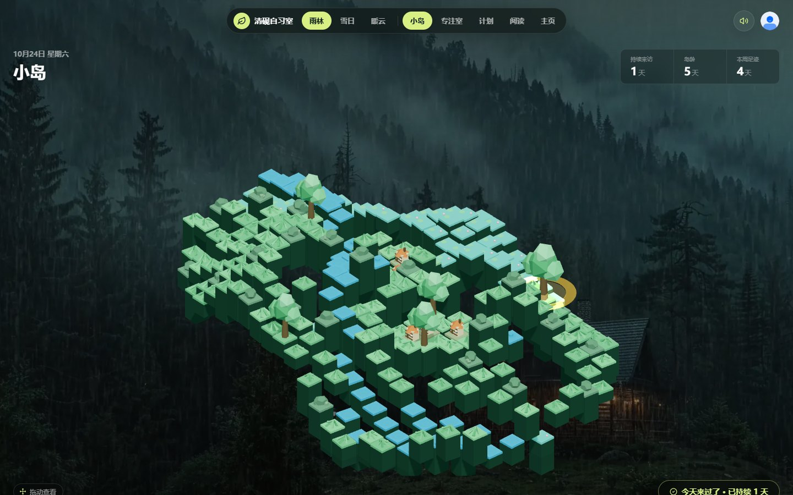
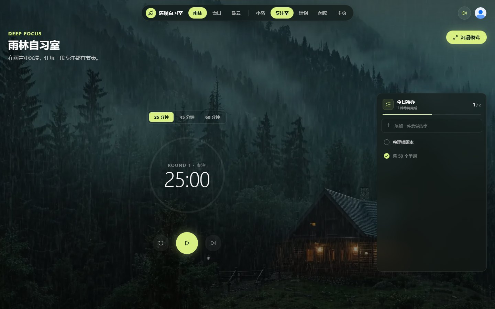
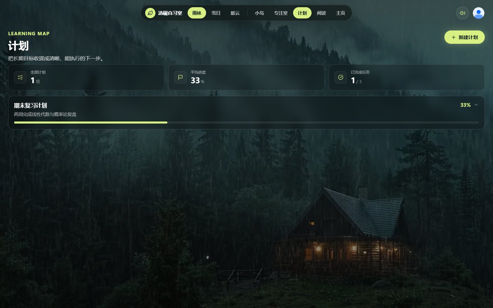
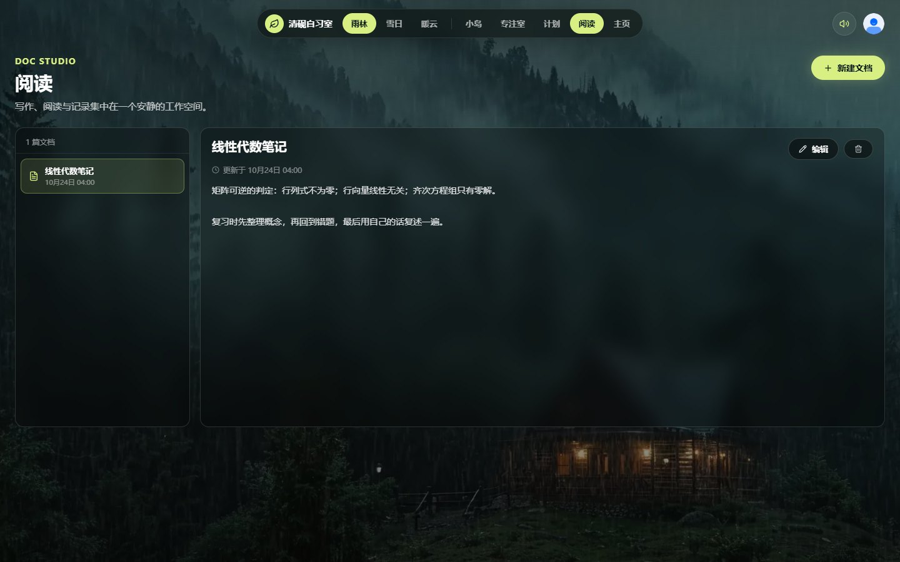
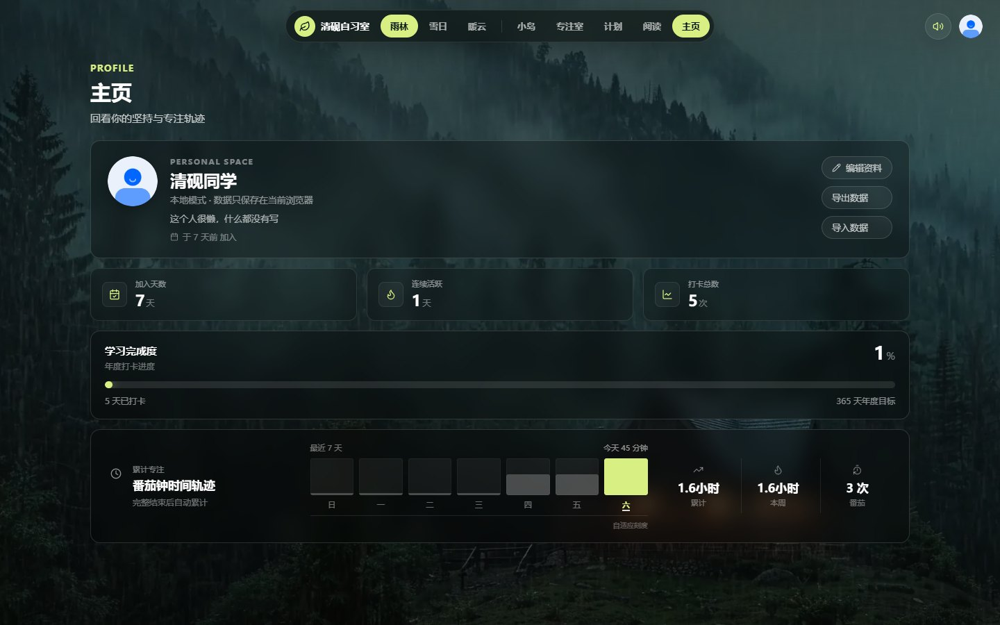
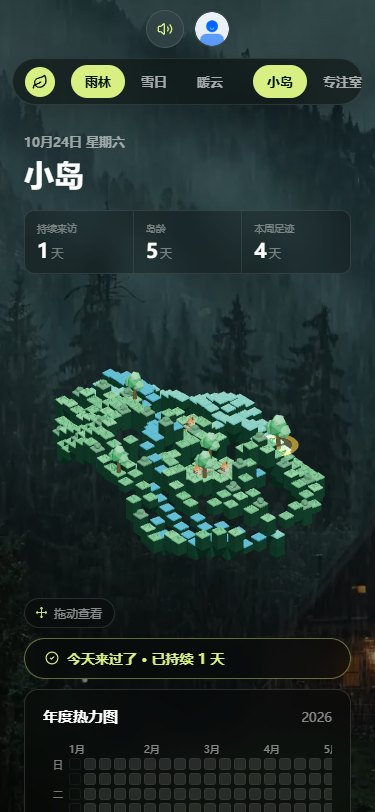

# 清砚自习室

一个面向学习者的沉浸式自习空间。它把 3D 小岛打卡、番茄专注、学习计划、阅读笔记和主页统计放进同一个界面，用雨林、雪日、暖云三种场景帮助用户进入专注状态。

**在线体验：** https://qingyan-study-room-j8vzdjdlheu.qoder.website



## 功能

- **小岛打卡**：3D 像素小岛随打卡成长，展示持续来访、岛龄、本周足迹和年度热力图。
- **专注室**：25 / 45 / 60 分钟番茄钟，沉浸模式，今日待办，以及 Web Audio 实时合成的雨声与雪声。
- **学习计划**：把长期目标拆成任务，记录完成状态和整体进度。
- **阅读笔记**：新建、编辑和保存文档，集中管理学习记录。
- **主页统计**：加入天数、连续活跃、打卡总数、年度进度和最近 7 天专注轨迹。
- **场景切换**：雨林、雪日、暖云三套背景与主色。
- **数据备份**：数据默认保存在浏览器 localStorage，主页支持导出 / 导入 JSON。

## 界面预览

<p align="center">
  
  
</p>
<p align="center">
  
  
</p>
<p align="center">
  
</p>

## 技术栈

| 部分 | 技术 |
| --- | --- |
| 前端框架 | Vue 3 + TypeScript + Vite |
| UI 与图标 | Element Plus、lucide-vue-next |
| 3D 场景 | Three.js |
| 状态与存储 | Vue Composition API、localStorage |
| 测试 | Vitest |
| 可选后端 | Qoder Sites Functions + Database（账号与云同步） |

## 本地运行

```bash
pnpm install

# 终端 1：本地 Function fixture，模拟账号与云端数据
node dev/function-local.mjs

# 终端 2：前端开发服务器
pnpm dev
```

Vite 已把 `/functions/v1/app` 代理到 `http://127.0.0.1:8000`。如果只想查看纯前端页面，也可以直接构建并预览 `dist/`。

## 项目结构

```text
src/
  views/studyRoom/   自习室页面、小岛、专注室、计划、阅读、主页
  session/           账号与云端同步状态
  api/               同步接口
  lib/               图标、资料、本地存储与备份
functions/           Qoder Sites Function（账号与云端数据）
dev/                 本地 Function fixture
tests/               Function 测试
docs/screenshots/    界面截图
```

## 检查与构建

```bash
pnpm typecheck
pnpm test
pnpm build
```

## License

本项目仅供学习、研究与非商业用途，采用 **PolyForm Noncommercial License 1.0.0**。商业使用需另行授权，详见 [LICENSE](LICENSE)。
