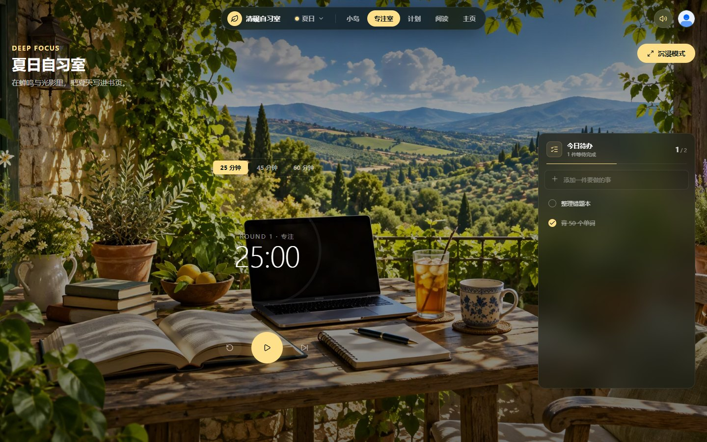
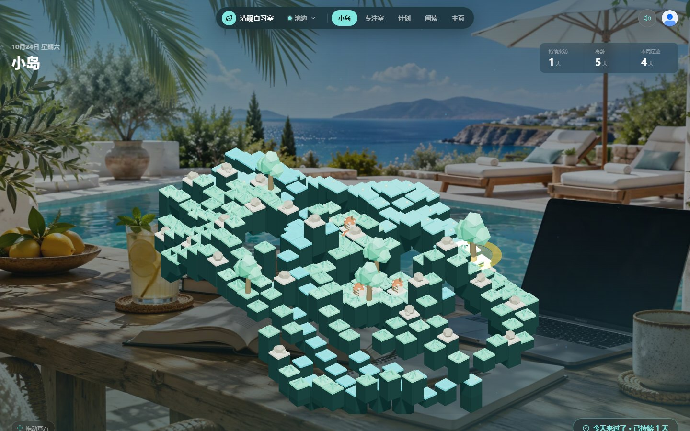
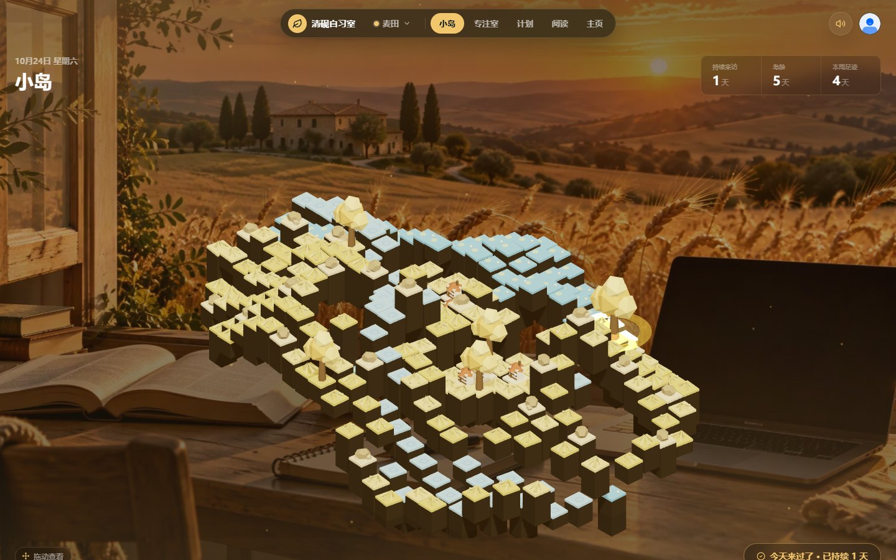

# 栖心自习室

一个面向学习者的沉浸式自习空间。它把 3D 小岛打卡、番茄专注、学习计划、阅读笔记和主页统计放进同一个界面，用雨林、雪日、星夜、海岸、麦田等自然场景帮助用户进入专注状态。

**在线体验：** https://qingyan-study-room-j8vzdjdlheu.qoder.website


## 本地账号

首次打开时可以创建本地账号。用户名、密码哈希和登录状态只保存在当前浏览器；不同账号的自习数据相互隔离，刷新或重新打开会保持登录。第一个创建的账号会自动接管旧版本机数据。

本地账号用于本机多用户隔离，不是服务端安全认证。清除浏览器数据或更换设备会丢失，请在主页导出备份。


## 功能

- **本地账号**：本机注册 / 登录 / 退出，PBKDF2 密码哈希，会话保持与多账号数据隔离。
- **小岛打卡**：3D 像素小岛随打卡成长，展示持续来访、岛龄、本周足迹和年度热力图。
- **专注室**：25 / 45 / 60 分钟番茄钟，沉浸模式，今日待办，以及 Web Audio 实时合成的环境音。
- **结束提醒**：自定义提示文字，专注结束后播报语音并响起提示铃；页面切到后台也能准点提醒。
- **学习计划**：把长期目标拆成任务，记录完成状态和整体进度。
- **阅读笔记**：新建、编辑和保存文档，集中管理学习记录。
- **主页统计**：加入天数、连续活跃、打卡总数、年度进度和最近 7 天专注轨迹。
- **场景切换**：雨林、雪日、暖云、星夜、海岸、晨光、夏日乡村阳台、池边、麦田九套背景与主色。
- **数据备份**：数据默认保存在浏览器 localStorage，主页支持导出 / 导入 JSON。

## 背景

九套可切换背景：雨林、雪日、暖云、星夜、海岸、晨光、夏日乡村阳台、池边、麦田。点击顶部场景按钮打开背景选择器，选择会保存在本机。切换时，3D 小岛配色、玻璃面板、按钮主色和页面光效会一起切换到对应场景风格。

背景带有缓慢漂移效果，并按场景叠加雨丝、雪花、星点、花粉或水光粒子；系统开启“减少动态”时会自动静止。

每套背景配有独立的合成环境音：雨声、雪落、云影、夜虫、海浪、晨鸟、蝉鸣、水光、麦浪。右上角音量按钮可以调节或静音，切换背景时环境音会同步切换。

<p align="center">
  
  
  
</p>
<p align="center">
  
  
</p>

## 界面预览

<p align="center">
  
  
</p>
<p align="center">
  
  
</p>
<p align="center">
  
</p>

## 技术栈

| 部分 | 技术 |
| --- | --- |
| 前端框架 | Vue 3 + TypeScript + Vite |
| UI 与图标 | Element Plus、lucide-vue-next |
| 3D 场景 | Three.js |
| 状态与存储 | Vue Composition API、localStorage |
| 测试 | Vitest |
| 可选后端 | Qoder Sites Functions + Database（账号与云同步） |

## 本地运行

```bash
pnpm install

# 终端 1：本地 Function fixture，模拟账号与云端数据
node dev/function-local.mjs

# 终端 2：前端开发服务器
pnpm dev

# 或者只跑纯前端静态模式（数据保存在 localStorage）
pnpm dev:static
```

Vite 已把 `/functions/v1/app` 代理到 `http://127.0.0.1:8000`。静态模式不需要后端，可直接构建：

```bash
pnpm build:static
pnpm preview
```

## 语音提醒服务

专注结束的提示语音默认走**阿里云百炼 Qwen3-TTS**（`qwen3-tts-flash`，与 qc-student 用的是同一套服务与音色），由 `cloudflare/chat-worker` 的 `POST /api/tts` 代取：

- 页面只发 `{ text, voice, speed }`，API Key 存在 Worker secret 里，不会出现在前端；上游返回的是带签名的 http 直链，由 Worker 转成音频字节再回给页面，避免 HTTPS 页面加载混合内容被拦。
- 云端不可用、未配置或请求失败时，自动回退到浏览器内置语音（`speechSynthesis`），提醒不会因此消失。
- 计费按字符（一次响应里的 `usage.characters` 即为计费字数），新用户有 90 天免费额度，具体单价以百炼控制台为准；同一段提示文字会在前端缓存，重复轮次不再重复合成。

部署（改动 worker.js 或换密钥后执行一次）：

```bash
npx wrangler secret put QWEN_TTS_API_KEY --config cloudflare/chat-worker/wrangler.toml
npx wrangler deploy --config cloudflare/chat-worker/wrangler.toml
```

本地联调：`.dev.vars` 里放 `QWEN_TTS_API_KEY=...`（已被 gitignore），跑 `pnpm chat:dev`，再用
`VITE_TTS_API_URL=http://127.0.0.1:8787/api/tts pnpm dev:static` 启动前端。

## 项目结构

```text
src/
  views/studyRoom/   自习室页面、小岛、专注室、计划、阅读、主页
  session/           账号与云端同步状态
  api/               同步接口
  lib/               图标、资料、本地存储与备份
functions/           Qoder Sites Function（账号与云端数据）
dev/                 本地 Function fixture
tests/               Function 测试
docs/screenshots/    界面截图
```

## 检查与构建

```bash
pnpm typecheck
pnpm test
pnpm build
pnpm build:static
```

## License

本项目仅供学习、研究与非商业用途，采用 **PolyForm Noncommercial License 1.0.0**。商业使用需另行授权，详见 [LICENSE](LICENSE)。
