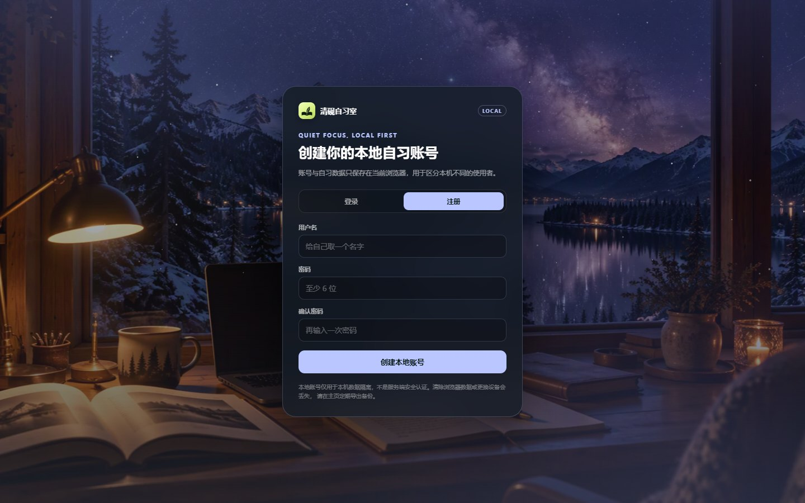
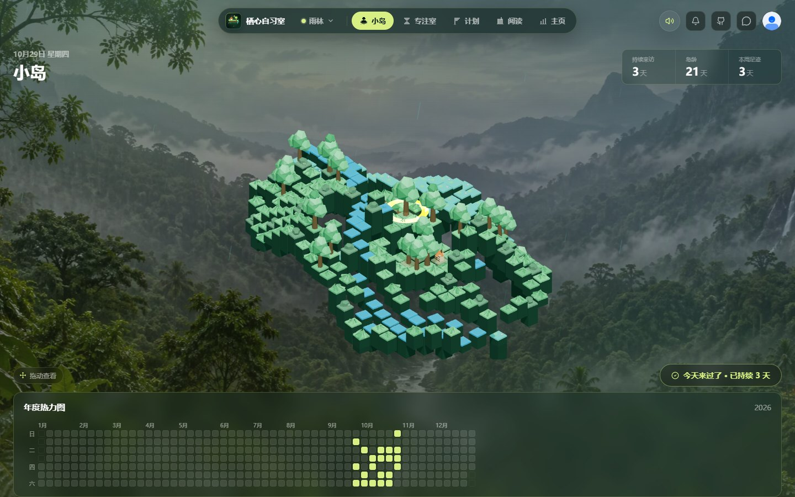
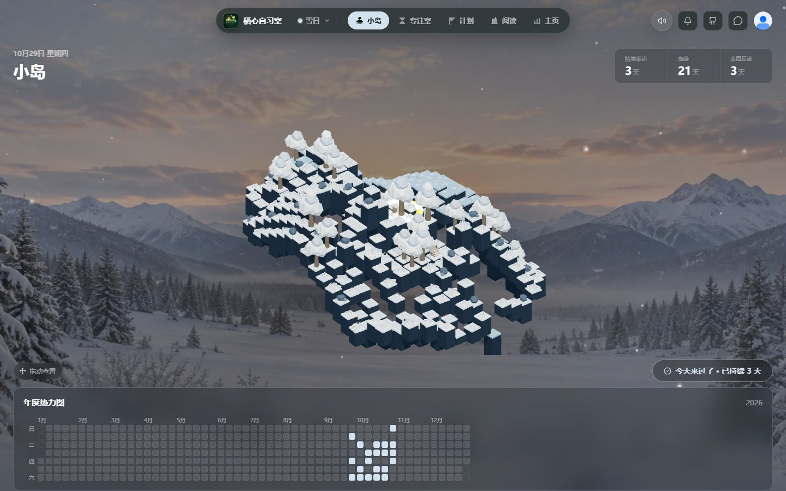
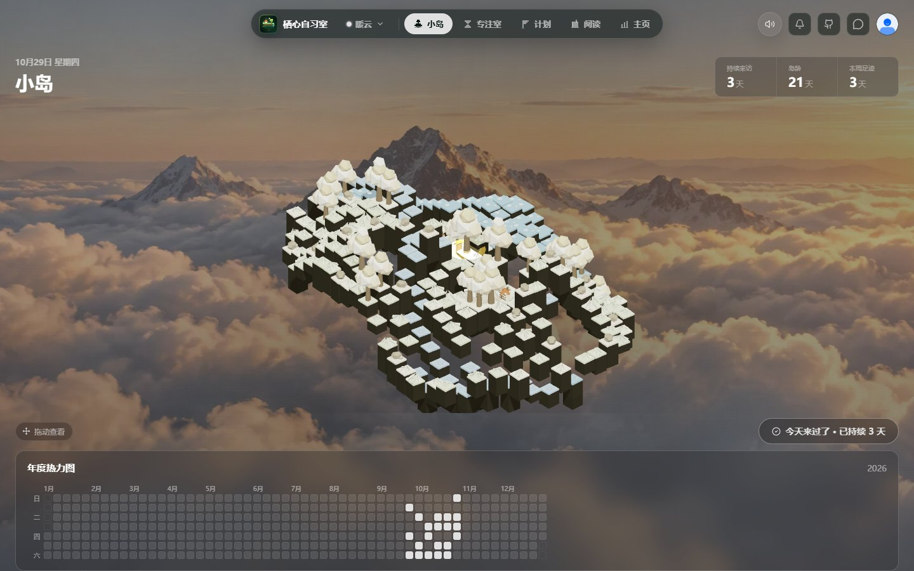
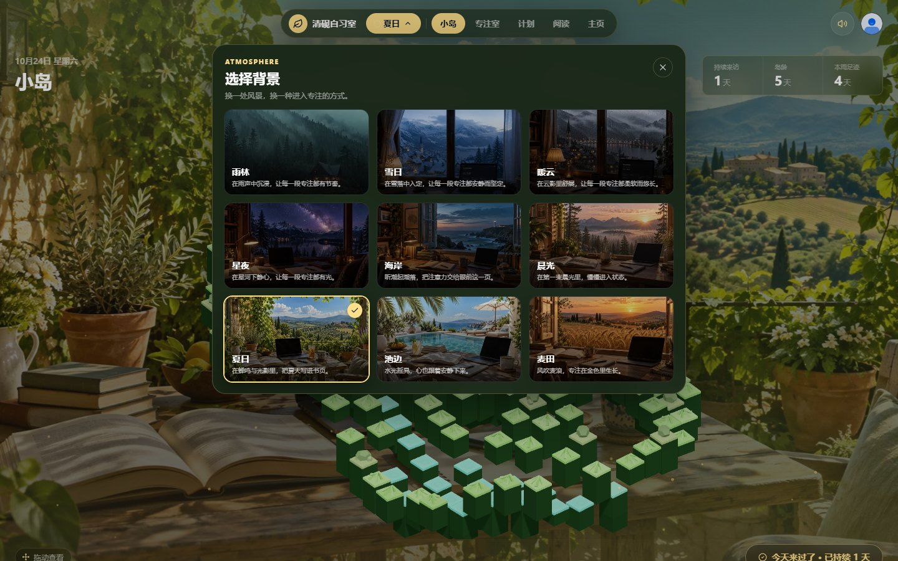
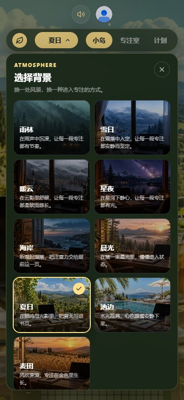
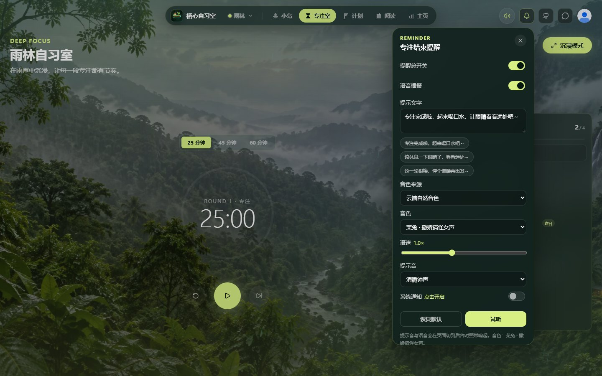
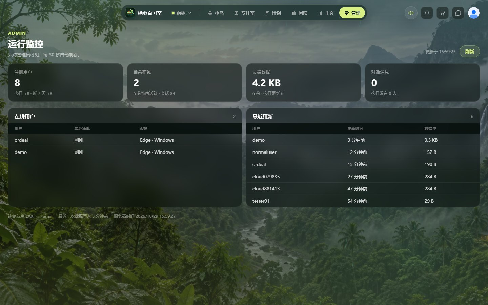

# 栖心自习室

一个面向学习者的沉浸式自习空间。它把 3D 小岛打卡、番茄专注、学习计划、阅读笔记、主页统计和一个小型对话室放进同一个界面，用雨林、雪日、星夜、海岸、麦田等自然场景帮助用户进入专注状态。

**在线体验：** https://qixin-study-room-j8vzdjdlheu.qoder.website


## 账号与云端数据

账号与自习数据都放在云端（Cloudflare Worker + D1），换浏览器、换设备、换访问地址，登录后数据都在：

- 注册需要 QQ 邮箱验证码；登录可以填用户名或邮箱；忘记密码用邮箱验证码重置，老账号也能在登录页把邮箱绑定到原账号。
- 注册 / 登录由 Worker 校验，密码用 PBKDF2-SHA256 加盐哈希后存储，登录态是 90 天有效的会话 token。
- 本机 `localStorage` 只作为离线缓存与未同步队列：改动先在本地落盘，1.2 秒防抖后推云端；断网时攒着，联网或每 20 秒自动补推。
- 每份数据带 `revision` 版本号，多设备同时写时按「谁更晚修改」取舍，不会互相覆盖。
- 首次打开仍会看到创建账号的界面；同一个账号在另一台设备上登录即可继续。



## 功能

- **云端账号**：QQ 邮箱验证码注册、用户名或邮箱登录、邮箱找回密码与老账号绑定邮箱；密码哈希与登录态由服务端保管，数据跟账号走。
- **小岛打卡**：3D 像素小岛随打卡成长，展示持续来访、岛龄、本周足迹和年度热力图。
- **专注室**：25 / 45 / 60 分钟番茄钟，沉浸模式，今日待办，以及 Web Audio 实时合成的环境音；切到小岛、计划等其他页签时计时和结束提醒仍继续运行。
- **结束提醒**：自定义提示文字，专注结束后播报语音并响起提示铃；页面切到后台也能准点提醒。
- **学习计划**：把长期目标拆成任务，记录完成状态和整体进度。
- **阅读笔记**：新建、编辑和保存文档，集中管理学习记录。
- **主页统计**：加入天数、连续活跃、打卡总数、年度进度和最近 7 天专注轨迹。
- **对话室**：顶栏进入，消息存 D1，带头像与限流。
- **管理后台**：管理员可见「管理」页签，查看注册用户、在线用户、云端数据量、登录地点、近 14 天登录 / 注册趋势和最近登录记录；图表由 ECharts 绘制。
- **场景切换**：雨林、雪日、暖云、星夜、海岸、晨光、夏日乡村阳台、池边、麦田九套背景与主色。
- **数据备份**：主页支持导出 / 导入 JSON（打卡、计划、笔记、昵称头像、场景）。

## 背景

九套可切换背景：雨林、雪日、暖云、星夜、海岸、晨光、夏日乡村阳台、池边、麦田。点击顶部场景按钮打开背景选择器，选择会保存在本机。切换时，3D 小岛配色、玻璃面板和按钮主色会一起换成对应场景的配色。

背景做的是"很轻"的动效：底图缓慢推拉（64–104 秒一个来回，缩放幅度 1.4%），再叠三层景深的粒子——远景更淡更慢、近景更大更亮，雨丝角度与雪花飘向跟随同一条慢速风场。刻意没有做整屏光带、模糊重影和明暗呼吸，避免长时间盯着晕；系统开启"减少动态"时全部静止。

<p align="center">
  
  
  
</p>
<p align="center">
  
  
</p>

每套背景配有独立的合成环境音：雨声、雪落、云影、夜虫、海浪、晨鸟、蝉鸣、水光、麦浪。合成用立体声底噪（左右声道独立噪声）铺开声场，瞬态走一条生成式混响总线，雨滴、蟋蟀、鸟叫、浪涌、水泡、麦浪都用随机间隔触发并带随机音高与声像，听不出 LFO 式的周期感。右上角音量按钮可以调节或静音，切换背景时环境音会同步切换。

## 界面预览

<p align="center">
  
  
</p>
<p align="center">
  
  
</p>
<p align="center">
  
  
</p>
<p align="center">
  
</p>

## 云端服务

前端是纯静态构建，服务端能力集中在 `cloudflare/chat-worker` 一个 Worker（配一个 D1 库）：

| 接口 | 作用 |
| --- | --- |
| `POST /api/auth/register` `login` `logout`、`GET /api/auth/me` | 账号注册、用户名或邮箱登录、退出与身份校验（PBKDF2 + 会话 token） |
| `POST /api/auth/email-code` `reset-password` `bind-email` | 邮箱验证码：注册、忘记密码重置、老账号绑定邮箱 |
| `POST /api/presence` | 每分钟上报活跃，用于「在线用户」统计 |
| `GET` / `PUT /api/state` | 拉取 / 推送整份自习数据（带 revision 冲突检测） |
| `GET /api/admin/stats` | 管理员专属：用户数、在线人数、登录地点、登录 / 注册趋势、云端数据量、最近更新 |
| `POST /api/tts` | 专注结束的提示语音合成（见下节） |
| `GET` / `POST /api/chat` | 对话室消息读写 |

管理员由 Worker 密钥 `ADMIN_USERNAMES`（逗号分隔的用户名）或用户表 `is_admin` 决定，每次请求实时判定；导航里的「管理」页签只对管理员显示，直接改地址强行访问也会被拦回小岛页。

### 邮箱验证码与登录地点

- 邮件走 QQ 邮箱 SMTP（`smtp.qq.com:465`，SSL + 授权码），由 Worker 通过 TCP socket 直连发送；邮箱账号、授权码和验证码密钥只放在 Worker secret 里，不进仓库和前端。
- 6 位验证码 10 分钟有效，60 秒可重发；同一邮箱每小时最多 5 封、同一 IP 每小时最多 20 封；验证码只存 HMAC 指纹，单码最多尝试 5 次。
- 登录时读取 Cloudflare 自带的国家 / 省 / 城市 / 边缘节点信息，随会话保存；管理页只展示城市级位置，不保存原始 IP。
- 找回密码后该账号的所有旧会话立即失效，其他设备需要重新登录。

所有数据都在 Cloudflare 免费额度内（Workers 每天 10 万请求、D1 5GB 存储），不需要额外服务器。

## 语音提醒

专注结束的提示语音默认走**阿里云百炼 Qwen3-TTS**（`qwen3-tts-flash`），由 Worker 的 `POST /api/tts` 代取：

- 页面只发 `{ text, voice, speed }`，API Key 存在 Worker secret 里，不会出现在前端；上游返回的是带签名的 http 直链，由 Worker 转成音频字节再回给页面，避免 HTTPS 页面加载混合内容被拦。
- 开始计时时就预取并缓存语音，到点直接经音频时钟播放；到点这一刻绝不等待网络——云端不可用或超时就立刻用浏览器语音兜底。
- 计费按字符（响应里的 `usage.characters` 即为计费字数），新用户有 90 天免费额度，具体单价以百炼控制台为准；同一段文字只合成一次。

## 技术栈

| 部分 | 技术 |
| --- | --- |
| 前端框架 | Vue 3 + TypeScript + Vite |
| UI 与图标 | Element Plus、lucide-vue-next、自绘像素图标 |
| 图表 | ECharts（管理页，按需加载） |
| 3D 场景 | Three.js |
| 状态 | Vue Composition API，本地缓存 + 云端同步 |
| 服务端 | Cloudflare Worker + D1（账号、数据、对话室、TTS 代理、管理统计） |
| 语音合成 | 阿里云百炼 Qwen3-TTS（服务端持密钥） |
| 测试 | Vitest |

## 本地运行

```bash
pnpm install

# 前端（静态模式，账号与数据走云端）
pnpm dev:static

# 云端服务：本地起 Worker，需要 .dev.vars 里配好密钥
pnpm chat:dev
```

本地联调时用 `VITE_CLOUD_API_URL=http://127.0.0.1:8787` 指向本地 Worker（`.dev.vars` 需要 `ADMIN_USERNAMES`；TTS 需要 `QWEN_TTS_API_KEY`；邮箱验证码需要 `MAIL_HOST` `MAIL_PORT` `MAIL_SECURE` `MAIL_USERNAME` `MAIL_PASSWORD` `MAIL_SENDER_NAME` 和 `EMAIL_CODE_SECRET`）。

部署服务端（改 `worker.js` / `study-cloud.js` 或换密钥后执行）：

```bash
npx wrangler secret put QWEN_TTS_API_KEY --config cloudflare/chat-worker/wrangler.toml
npx wrangler secret put ADMIN_USERNAMES --config cloudflare/chat-worker/wrangler.toml
npx wrangler secret put MAIL_HOST --config cloudflare/chat-worker/wrangler.toml
npx wrangler secret put MAIL_PORT --config cloudflare/chat-worker/wrangler.toml
npx wrangler secret put MAIL_SECURE --config cloudflare/chat-worker/wrangler.toml
npx wrangler secret put MAIL_USERNAME --config cloudflare/chat-worker/wrangler.toml
npx wrangler secret put MAIL_PASSWORD --config cloudflare/chat-worker/wrangler.toml
npx wrangler secret put MAIL_SENDER_NAME --config cloudflare/chat-worker/wrangler.toml
npx wrangler secret put EMAIL_CODE_SECRET --config cloudflare/chat-worker/wrangler.toml
npx wrangler deploy --config cloudflare/chat-worker/wrangler.toml
```

`MAIL_USERNAME` 是发信的 QQ 邮箱，`MAIL_PASSWORD` 是 QQ 邮箱设置里生成的 **SMTP 授权码**（不是 QQ 登录密码）；`MAIL_FROM` 不填时默认使用 `MAIL_USERNAME`。`EMAIL_CODE_SECRET` 用一段足够长的随机字符串。

## 项目结构

```text
src/
  views/studyRoom/   自习室页面：小岛、专注室、计划、阅读、主页、管理后台
  api/               云端接口（账号、状态、对话、TTS）
  lib/               图标、资料、显示名、备份
cloudflare/
  chat-worker/       Cloudflare Worker + D1（账号/数据/对话/TTS/管理统计）
docs/screenshots/    界面截图
tests/               Function 测试
```

## 检查与构建

```bash
pnpm typecheck
pnpm test
pnpm build:static
```

## License

本项目采用 **PolyForm Strict License 1.0.0**：只允许个人学习、研究、试验等**非商业**用途，
**不允许分发**（包括公开发布、公开托管站点、转载、二次分享）和**修改**，商业使用需另行授权。
详见 [LICENSE](LICENSE)。